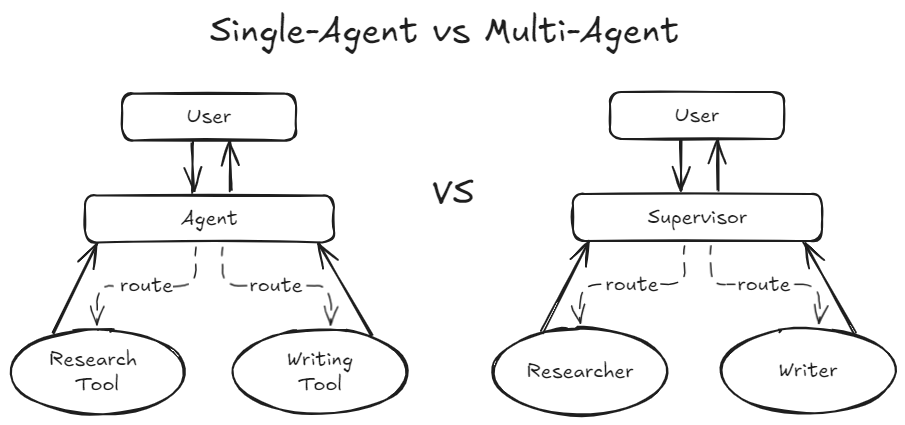
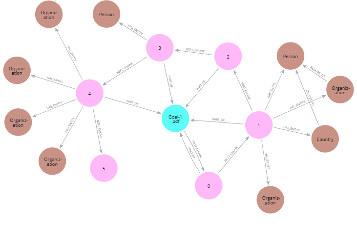

# GenAI Sandbox

Welcome to **GenAI Sandbox**! This repository is dedicated to my personal experiments and investigations in Generative AI (GenAI) and Natural Language Processing (NLP). Here, you'll find explorations, comparisons, and experiments related to different aspects of these technologies, with an open invitation to the community to engage, learn, and contribute.

## Table of Contents

- [Experiments and Investigations](#experiments-and-investigations)
  - [Comparison Between Single-Agent and Multi-Agent Approaches](#lab-1)
  - [Template-Based PowerPoint Generation](#lab-2)
  - [Graph RAG with Neo4j and LangChain](#lab-3)
- [Getting Started](#getting-started)
- [Contributing](#contributing)
- [License](#license)

<a name="labs"/></a>
## Experiments and Investigations
[Back to ToC](#toc)

Below is a list of the experiments and investigations included in this repository:

<a name="lab-1"/></a>
### 1. [Comparison Between Single-Agent and Multi-Agent Approaches](./single_vs_multi_agent)

This investigation aims to compare the effectiveness of single-agent versus multi-agent approaches for building an Article Writer app. It includes two notebooks that demonstrate each approach:
- Single-Agent Approach: Implemented using LangChain with a Research Tool and a Writing Tool, both utilizing LLMs.
- Multi-Agent Approach: Implemented using CrewAI with two agent executors (Researcher and Writer) working collaboratively.

<p align="center">
  
</p>

<center>A visual comparison of single-agent and multi-agent approaches.</center>
<center>Image source: Author.</center>

The goal is to explore the capabilities, strengths, and limitations of each approach, and to determine whether a multi-agent system provides significant advantages over a single-agent setup.

<a name="lab-2"/></a>
### 2. [Template-Based PowerPoint Generation](./template-based-pptx-generation)

This project provides a Python-based solution for generating PowerPoint presentations from templates. It allows users to:
- Define slide templates with placeholders for dynamic content
- Use JSON configuration to specify presentation structure and content
- Generate multiple presentations from the same template
- Support different slide types (title, section, content with bullet points)

Key features:
- Template-based slide generation
- JSON-based configuration
- Schema validation
- Support for bullet points and text replacement
- Automatic template slide removal

Example usage:
```bash
python main.py --template template.pptx --schema template_schema.json --config your_config.json --output generated.pptx
```

The system is particularly useful for:
- Creating consistent presentation series
- Automating presentation generation
- Maintaining brand consistency across presentations
- Integration with LLMs for automated content generation

<a name="lab-3"/></a>
### 3. [Graph RAG with Neo4j and LangChain](./graph-rag-with-neo4j-and-langchain)

This investigation explores the implementation of Graph-based Retrieval Augmented Generation (GraphRAG) using Neo4j graph database and LangChain framework.

<p align="center">
  
</p>

<center>Knowledge graph visualization showing entities and relationships extracted from documents.</center>
<center>Image source: Author.</center>

The project includes multiple notebooks demonstrating different approaches:
- **Indexing Pipeline for Lexical Search**: Building knowledge graphs from PDF documents using Cypher queries
- **Inference Pipeline for Lexical Search**: Querying the knowledge graph using lexical/keyword-based search
- **Inference Pipeline for Semantic Search**: Implementing vector-based semantic search over the graph
- **Indexing and Inference for Semantic Search**: Complete end-to-end implementation with embeddings

Key features:
- Multiple knowledge graph construction methods (automatic, semi-automatic, manual)
- Integration with Neo4j Aura cloud service or local instances
- Support for both lexical and semantic search strategies
- Entity resolution and relationship extraction using LLMs
- Embedding generation for semantic search capabilities

The notebooks work with UN Sustainable Development Goals documents as sample data, demonstrating:
- Document loading and chunking strategies
- Automatic entity and relationship extraction
- Graph visualization and schema exploration
- Different query approaches (Cypher, vector search)

<a name="getting-started"/></a>
## Getting Started
[Back to ToC](#toc)

To get started with the GenAI Sandbox, follow these steps:

1. **Clone the Repository**: Clone this repository to your local machine using:
   ```bash
   git clone https://github.com/yourusername/genai-sandbox.git
   ```

2. **Run Experiments**: Inside each experiment folder, you will find specific setup instructions, including the installation of necessary dependencies or configuration required to run that particular experiment. Follow those instructions to reproduce the results.

<a name="contributing"/></a>
## Contributing
[Back to ToC](#toc)

**GenAI Sandbox** is primarily a personal exploration project, but contributions are welcome! If you have ideas, feedback, or suggestions, feel free to open an issue or a pull request. Let's learn and innovate together!

<a name="license"/></a>
## License
[Back to ToC](#toc)

This repository is open-sourced under the [MIT License](LICENSE).
